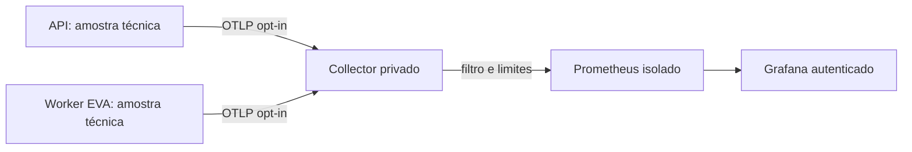

# EVA — validação isolada de telemetria e continuidade

Atualização: 13/11/2026. Responsável: Owner / Administrador da Plataforma. Esta entrega avança D; não encerra B, F ou G.

## Arquitetura e isolamento

O código usa OTLP/HTTP JSON de métricas, sem auto-instrumentar requisições, documentos, prompts, SQL ou resultados. Não adiciona SDK, listener público ou nova dependência npm. O worker permanece privado. Cada processo usa um UUID efêmero próprio para distinguir reinícios e sobreposição de deploys; não identifica usuário, organização ou documento.

O exportador reconstrói uma lista fixa de métricas: RSS, heap, CPU em um núcleo, uptime, idade da amostra, event loop, pressão dos pollers e contagens/histogramas de etapas. A lista de etapas é fixa. Os histogramas são cumulativos, têm origem temporal de processo e 16 buckets fixos, sem armazenamento de cada duração. p95/p99 por etapa no Grafana são estimativas por buckets; não são SLO nem duração integral da jornada. Event loop é outra grandeza.

Uma tentativa por minuto, no máximo uma em andamento, corpo de até 32 KiB, resposta de até 1 KiB e prazo total de dois segundos. Sem fila em memória/disco, redirecionamento ou repetição de mensagens. Falhas impõem cooldown de um a cinco minutos. A aplicação não aguarda a rede do exportador; shutdown cancela o transporte. Perda de amostras não provoca reexecução da EVA; contagens cumulativas posteriores preservam as operações medidas enquanto o processo continua vivo.

## Configuração de produção: permanece desativada

`ENERGYOS_OTLP_METRICS_ENABLED` exige exatamente `true`; ausente significa desativado. O kill switch existente `ENERGYOS_RUNTIME_OBSERVABILITY_ENABLED=false` também interrompe amostras e exportação no próximo bootstrap. Reiniciar de forma controlada para alterar configuração.

`ENERGYOS_OTLP_METRICS_ENDPOINT` aceita somente HTTP em `/v1/metrics`, sem credenciais, query ou fragmento. Destinos: loopback para ensaios ou `energyos-otel-collector.railway.internal:4318` para futura operação privada. Nenhuma chave de serviço deve ser passada ao exportador. Não habilitar um endpoint público para contornar essa regra.

Esta entrega não cria serviços pagos nem habilita exportação em produção. Primeiro validar o stack isolado, revisar capacidade e destino operacional, autenticação do Owner, TLS do acesso administrativo, retenção, alertas e recuperação. Se a operação exigir recursos recorrentes novos, preparar o custo concreto antes da ativação. Grafana não deve ficar público sem acesso administrativo autenticado e TLS. Não substituir RBAC/RLS do EnergyOS por autenticação do Grafana.

## Ensaios reproduzíveis

Arquivos em `ops/observability/`. As imagens têm versões fixas: Collector contrib 0.165.0, Prometheus 3.16.0 e Grafana 13.3.1. O Compose usa rede interna isolada, portas apenas em loopback, limites de CPU/memória/PIDs, filesystem somente leitura, capabilities removidas e armazenamento temporário. Não monta banco, documentos, logs ou credenciais de produção. A retenção isolada do Prometheus é 24 horas/128 MB, volátil e limitada pelo tmpfs; não serve como baseline persistente de produção.

Defina uma senha exclusiva de teste em `GRAFANA_ADMIN_PASSWORD`, sem imprimir, versionar ou reutilizar credenciais reais. Após o build do backend, execute `python3 ops/observability/verify.py`. O workflow `EVA isolated telemetry and scheduler` prepara a senha temporária e encerra apenas os containers desse ensaio ao terminar.

O ensaio real verifica Collector -> Prometheus -> dashboard provisionado, histograma de 10.000 operações CPU sintéticas, rejeição de métricas fora da lista, remoção de canários de descrição/atributos/escopo, indisponibilidade do Collector sem bloquear trabalho e recuperação. Os testes de transporte também cobrem timeout, 302/429/503 sem retry, recibos parciais/inválidos/grandes, cooldown e shutdown. O scheduler testa concorrência limitada, fila vazia, retomada de backlog, liberação de capacidade e diagnóstico com falha.

Não é teste representativo de carga financeira/OCR/IA/CCEE e não usa documentos de clientes. Não simula todas as falhas de rede/Auth, reordenação ou gravações financeiras do plano F. Nunca usar essa fixture como evidência de fechamento aprovado.

## Defesa de dados e operação

O Collector filtra nomes de métricas e etapas, remove descrições e atributos não permitidos e não exporta informações de escopo. Não tem pipeline de logs/traces. Os canários de privacidade precisam permanecer ausentes nas séries e metadados do Prometheus. Os limites de scrape, amostras, labels, retenção e consultas reduzem o risco de pressão no observador. A amostra tem timestamp próprio: scrape bem-sucedido de métrica antiga não equivale a processo saudável.

As regras de alerta são locais, sem destinatário externo configurado. Alertam sobre coletor indisponível, amostra ausente/antiga e event loop elevado; não afirmam que a API caiu quando apenas o coletor não responde. A visão Owner do EnergyOS continua sendo somente agregados das organizações licenciadas. Monitoramento externo contínuo depende da ativação posterior em ambiente operacional.

Rollback: reverter a release ou deixar `ENERGYOS_OTLP_METRICS_ENABLED` ausente/false e reiniciar controladamente. O stack isolado pode ser encerrado pelo projeto Compose `energyos-telemetry-test`, sem tocar API, banco ou worker de produção. Não apagar/repetir recibos, documentos ou cálculos para testar observabilidade.

Referências: [OTLP JSON](https://opentelemetry.io/docs/specs/otlp/#json-protobuf-encoding), [modelo de métricas](https://opentelemetry.io/docs/specs/otel/metrics/data-model/), [histogramas no Prometheus](https://prometheus.io/docs/practices/histograms/).
